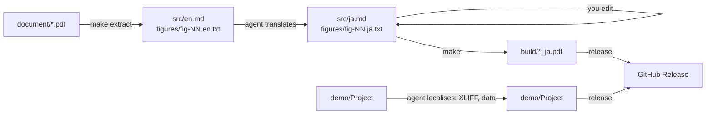

# 4D Technical Note Localisation

Template for translating a **4D technical note** (an English PDF) and **its companion 4D demo project**
into another language (Japanese by default), with GitHub Copilot doing the work and you making the
editorial decisions.

The PDF is never patched. It is **disassembled** into plain text, Markdown and figure label files.
You edit those, then **reassemble** the PDF with one command, as many times as you like.
Program code is copied byte for byte, and the build refuses to run if code was changed.



## Quick start

1. **Use this template** (on GitHub, *Use this template → Create a new repository*), then clone it with its
   submodule, which holds the agent skills (see [Agent instructions and skills](#agent-instructions-and-skills)):
   ```sh
   git clone --recurse-submodules https://github.com/<owner>/<repo>.git
   ```
2. Add the source material and push:
   - the English PDF → `document/<name>.pdf` (exactly one PDF)
   - the 4D project → `demo/<ProjectName>/` (the folder that contains `Project/`)
3. Start the agent. Use either:
   - **Locally** (Copilot CLI or the Copilot app, recommended): open the repository and prompt:
     > Localise this technical note and its demo into Japanese. Follow AGENTS.md and stop at every checkpoint for my review.
   - **Cloud agent:** open an issue with the **Localisation request** form and assign it to Copilot.
     The agent works in a pull request. Reply in the PR to give directions at each checkpoint.
4. Review at each **checkpoint** (see below). Edit files directly or tell the agent what to change.
5. Release: tell the agent *"release v1.0.0"*, or run the steps under [Release](#release).

## Checkpoints: where you decide

The agent stops and asks you at each of these points:

| # | After | You review / decide |
|---|---|---|
| 1 | `make inspect` | Detected heading, code and caption styles in `technote.json`; target language; output style |
| 2 | `make extract` | `src/en.md` reads correctly (headings, code blocks, figures in the right places); OCR'd figure text |
| 3 | First translation | `src/ja.md`, `glossary.md`: terminology and tone |
| 4 | Figures | Contact sheets `build/contact-N.png` and PDF; translated screenshots, unresolved wording/fonts and any captures needing manual confirmation |
| 5 | Demo data (optional) | Whether to replace the sample data (e.g. places) with local equivalents, and which ones |
| 6 | 4D project | Localisation plan: XLIFF scope, new attributes, UI behaviour |
| 7 | Release | Final PDF and demo; the repository README (from `.github/templates/README.technote.md`); version tag |

Edits are always safe. Generated output goes to `build/` only, and `make extract` never overwrites existing files.

## Files you edit

| File | What |
|---|---|
| `src/ja.md` | Translated text (Markdown). Keep body blocks parallel to `src/en.md`; the approved Japanese cover metadata omission is allowed (see below). **Don't touch code blocks.** |
| `figures/fig-NN.ja.txt` | Text drawn in figure NN, one line per line of `fig-NN.en.txt` (see below) |
| `figures/layout/fig-NN.json` | Optional per-label tweaks (size, weight, alignment, position) |
| `figures/fig-NN-ja.png` | Reviewed replacement image (mechanically translated screenshot or capture of the localised app) |
| `glossary.md` | Terminology decisions. Change a term here first. |
| `technote.json` | Document settings (normally written once by the agent) |

### Japanese editorial style

Translate the cover title, omit the `Technical Note NN-NN` identifier from the Japanese cover only, and format
the byline as `author（company role）`, preserving the name/company and translating the role. Keep `src/en.md`
and the original PDF unchanged; the cover omission is not a reason to alter the source.

Use the approved localised component/tool title consistently in prose, without renaming code identifiers or
substituting narrative terminology for resource-verified UI strings. Do not automatically append English glosses
on first occurrence. The editor's narrative terms include `シングルユーザー版` (standalone edition) and
`メソッドエディター` (Code Editor). Prefer verified equivalent current Japanese documentation links in translated
prose, without changing source English URLs or code.

The full rules and verified command-reference examples are in the
[translation conventions](.github/instructions/technote-translation.instructions.md#translation-conventions);
record document-specific titles and terminology in `glossary.md`.

### Figure text rules

Line N of `fig-NN.ja.txt` corresponds to line N of `fig-NN.en.txt`:

- **identical to the English line:** the original pixels are kept. Use this for code, numbers and identifiers.
- **empty:** the English text is erased and nothing is drawn (to merge two lines into one).
- **anything else:** the English text is erased and this text is drawn in its place.

Per-label overrides in `figures/layout/fig-NN.json` → `items[N]`:
`"scale": 1.2`, `"size": 28`, `"weight": "light"|"regular"|"bold"`, `"align": "left"|"center"`,
`"dx"`, `"dy"`, `"box": [x, y, w, h]`, `"bg"`, `"fg"`, `"erase_pad"`.
Per figure: `"localize": false` keeps the image unchanged; `"replace": "fig-NN-ja.png"` uses a ready-made image.

### Screenshot translation

Use the `technote-localise-screenshots` skill for screenshots, not the generic diagram text overlay.
It preserves `figures/fig-NN.png`, mechanically replaces only the text in a separate
`figures/fig-NN-<tgt>.png`, and connects the reviewed result through the layout's `"replace"` key.
Keep `"localize": false` to bypass diagram rendering; `"replace"` takes precedence when present.

The skill uses the target-language XLIFF from a local **4D or 4D Server** installation for 4D's own UI,
and the demo's translated resources for demo labels. Fonts must match the actual context: 4D forms,
browser content, browser chrome and native system dialogs can use different fonts on macOS and Windows.
The target language, OS version, theme and display scale matter; a generic CJK font is not proof of fidelity.

When a native capture is needed, prefer a short shot list and let the editor capture the relevant window
manually. See [Mac captures and opening 4D editors](.github/instructions/technote-translation.instructions.md#mac-captures-and-opening-4d-editors)
for window shortcuts, permissions, `FORM EDIT` and `METHOD OPEN PATH`. Stop automation immediately when
the editor takes over; use `4dcli` only for an approved full-GUI capture workflow.
**tool4d is English-only** and cannot verify localised native UI. Missing resources, fonts, demo sources or a
matching platform are blockers, not permission to invent UI. Remaining uncertainty requires manual
confirmation or a localised capture before acceptance at checkpoint 4.

## Commands

| Command | Does |
|---|---|
| `make setup` | Create `.venv` and install Python packages |
| `make inspect` | Analyse the PDF and suggest `technote.json` (written only if not configured yet) |
| `make extract` | Disassemble the PDF (one time; never overwrites) |
| `make check` | Verify code blocks are unchanged and figure references match |
| `make figures` | Render localised figures into `build/figures/` |
| `make review` | Contact sheets comparing original and localised figures (`FIGS="02 05"` to select) |
| `make` | check → figures → PDF in `build/` |
| `make demo-zip` | Zip each committed 4D project in `demo/` into `build/<Name>.zip` |
| `make release-assets` | PDF + demo zips |
| `make clean` | Remove `build/` |

## Requirements

| | macOS (local) | Linux (cloud agent / Actions) |
|---|---|---|
| Python 3.10+ | ✓ | ✓ (preinstalled) |
| Google Chrome / Chromium | `/Applications/Google Chrome.app` | preinstalled on GitHub runners, or set `$CHROME` |
| Tesseract OCR | `brew install tesseract` | `apt install tesseract-ocr` |
| Japanese fonts for figures | Hiragino (built in) | `apt install fonts-noto-cjk` |
| tool4d (runs 4D test methods) | optional, `/Applications/tool4d/…` or `$TOOL4D` | not available, so 4D tests are skipped |
| 4D syntax checks | `4dlsp` skill: `tool4d-lsp-stdio` (provisioned into `tools/4dlsp/`) + tool4d | not set up, so syntax checks are skipped |

`.github/workflows/copilot-setup-steps.yml` prepares the Linux environment for the cloud agent.

> **Note:** figures and PDF text are rendered with Hiragino on macOS and Noto Sans CJK on Linux,
> so the two builds look slightly different. Build the final release on the platform you reviewed.

## Release

```sh
make release-assets                       # build/<name>_ja.pdf, build/<Demo>.zip
git tag v1.0.0 && git push origin v1.0.0
gh release create v1.0.0 build/*_ja.pdf build/*.zip --title "…" --notes "…"
```

Before the first release, the agent replaces this README with the converted document's own README, built from
`.github/templates/README.technote.md` (title, introduction, downloads, demo notes, differences, how to edit).
This usage guide then stays available in the template repository.

If you push a tag without creating the release yourself, `.github/workflows/release.yml` builds the assets
on Linux and publishes them. It skips the upload if the release already has assets.

## Agent instructions and skills

| Path | What |
|---|---|
| `AGENTS.md` | The agent's instructions: rules, workflow and checkpoints (Copilot, Codex; Claude Code via `CLAUDE.md`) |
| `.github/instructions/technote-translation.instructions.md` | Pipeline reference: `technote.json` keys, extraction, figures, reassembly, pitfalls |
| `.agents/` | Git submodule → [miyako/skills](https://github.com/miyako/skills), branch `dist`: the `technote-*` skills (figures, screenshots, glossary, demo data, 4D demo, release) and the generic 4D skills (`4dlocalise`, `4dstartup`, `4dlsp`, …) |

- In an existing clone, or if `.agents/` is empty: `git submodule update --init .agents`.
- `.github/workflows/update-skills.yml` moves `.agents` to the latest skills every Monday (or on demand from the
  Actions tab) and commits the new pointer. To update by hand:
  `git submodule update --remote .agents && git commit -m "Update skills" .agents`.
- Don't edit files under `.agents/`; improve the skill in miyako/skills instead.
- Screenshot translation requires `.agents/skills/technote-localise-screenshots/SKILL.md`. If missing, update the
  submodule after the skill is published to `dist`; until then, leave screenshots unchanged and report the blocker.
- Tools that the skills download (e.g. `tool4d-lsp-stdio` for syntax checks) go to `tools/4dlsp/` and similar
  folders, which are git-ignored. The pipeline scripts `tools/*.py` are committed.

## Layout

```
document/            original PDF (read-only)
src/                 en.md (extracted), ja.md (translation)
figures/             fig-NN.png, fig-NN.en.txt, fig-NN.ja.txt, layout/fig-NN.json
demo/<Name>/         4D project
data/                localised demo data (optional)
glossary.md          terminology
technote.json        document-specific settings
style/style.css      print stylesheet
tools/               pipeline (Python, committed); tools/4d*/ are provisioned by the skills (git-ignored)
AGENTS.md            agent instructions (CLAUDE.md points to it)
.agents/             skills (submodule miyako/skills, branch dist)
.github/             instructions/technote-translation.instructions.md, workflows, ISSUE_TEMPLATE,
                     templates/README.technote.md
build/               output (git-ignored)
```
